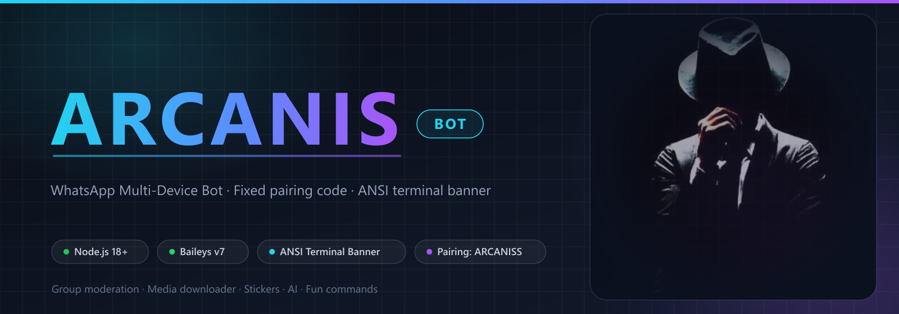
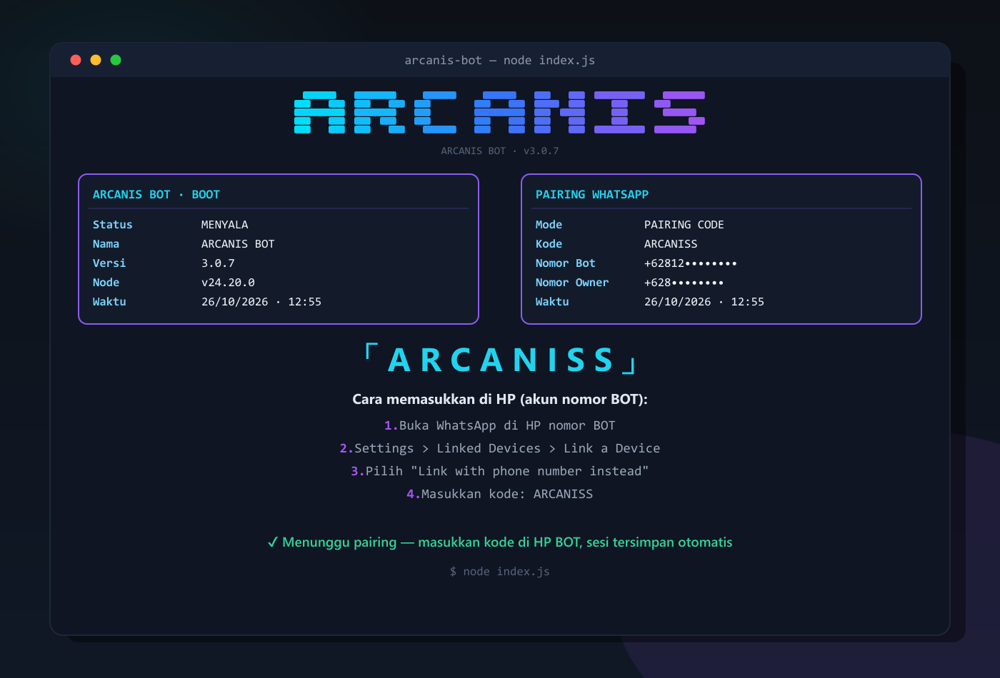
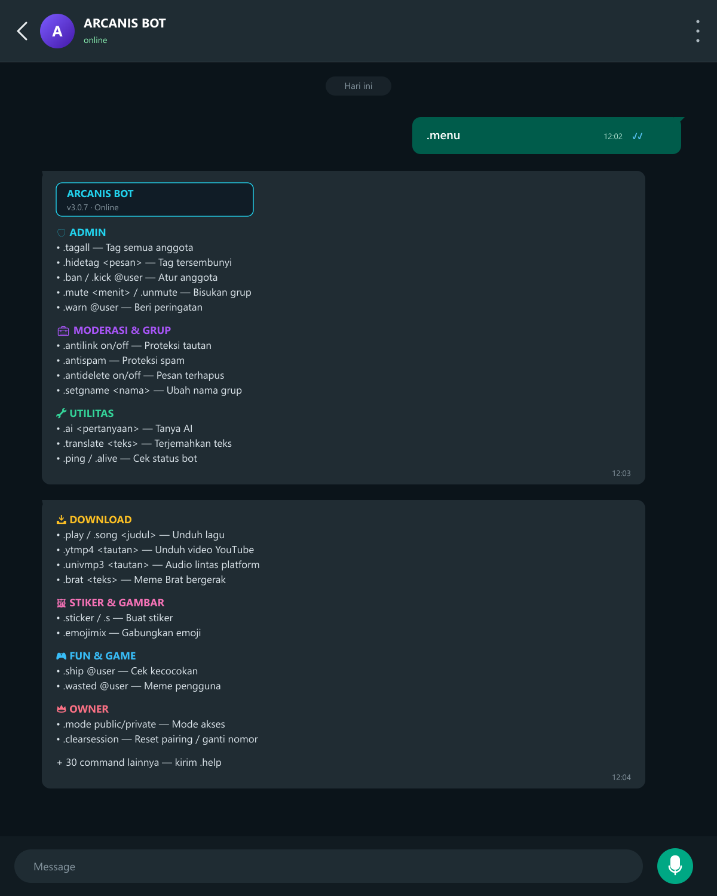

<div align="center">



# ARCANIS BOT

**WhatsApp multi-device bot** for group moderation, media downloads, stickers, AI utilities, and fun commands — built on [Baileys v7](https://github.com/WhiskeySockets/Baileys) with a beautiful ANSI terminal banner.

**English** · [Bahasa Indonesia](README.id.md)

</div>

## Contents

- [Why this bot](#why-this-bot)
- [Preview](#preview)
- [Features](#features)
- [Requirements](#requirements)
- [Installation](#installation)
- [Configuration](#configuration)
- [Running the bot](#running-the-bot)
- [Pairing your account](#pairing-your-account)
- [Command set](#command-set)
- [Project structure](#project-structure)
- [Troubleshooting](#troubleshooting)
- [Security notes](#security-notes)
- [Credits & license](#credits--license)

## Why this bot

- **Fixed pairing code `ARCANISS`** — no screenshots of QR codes to juggle. The bot prints an 8-character pairing code in a styled terminal banner; you type it in on the bot's phone.
- **Terminal-first experience** — a hand-crafted block-glyph ARCANIS logo, boot panel, and pairing panel drawn with ANSI colors (disable anytime with `NO_ANSI=1`).
- **Multi-device (MD)** — runs on one dedicated WhatsApp account while you keep using your personal one.
- **Serious moderation toolkit** — anti-link, anti-spam, anti-delete, warnings, tag tools, and group settings, plus a big media & utility command surface.
- **Split-proof menu** — long menus are chunked automatically so WhatsApp never truncates them.

## Preview

A peek at the terminal banner and pairing flow:

<table>
  <tr>
    <th width="57%">Terminal — boot + pairing code</th>
    <th width="43%">WhatsApp — <code>.menu</code></th>
  </tr>
  <tr>
    <td></td>
    <td></td>
  </tr>
</table>

## Features

| Category | Highlights |
| --- | --- |
| 🛡️ **Admin** | Tag all / hidden tag, kick, promote & demote, mute & unmute, warn & warnings, pin & unpin messages |
| 🧰 **Moderation** | Anti-link, anti-badword, anti-spam, anti-tag, anti-delete backup, group info, group lock, welcome & goodbye messages |
| 🔧 **Utilities** | AI chat (`.ai / .gpt / .gemini`), translation, URL-to-link converter, website screenshot, view-once viewer, JID lookup |
| 🖼️ **Stickers & images** | Sticker maker, sticker-to-image, re-take metadata, crop, blur, background removal, image upscaling, emoji mixer, Telegram sticker grab |
| 📥 **Downloads** | YouTube audio/video, TikTok, Instagram, Facebook, Twitter/X, Pinterest, Threads, Reddit, SoundCloud, Bilibili, cross-platform universal download |
| 🎮 **Fun & effects** | Ship & compatibility memes, user memes, anime actions, image effects, flag filters |
| 👑 **Owner control** | Public/private mode, sudo users, session cleanup, temp cleanup, profile picture setter, auto-typing/auto-read/auto-react toggles, PM blocker |

<details>
<summary><strong>Why a fixed pairing code?</strong></summary>

Most Baileys bots print a QR code you must screenshot within sixty seconds — painful on a headless server. A pairing code is just **8 characters typed on the phone**, survives retry prompts, and can't expire mid-scan. ARCANIS BOT still supports QR if you prefer it: start with `--qr` or `PAIRING_MODE=qr`.

</details>

## Requirements

- **Node.js 18+** (LTS 20 or 22 recommended)
- **npm**
- **ffmpeg** on PATH (optional but recommended) — needed for `.mp4to3` and HLS-only SoundCloud tracks (`.sc`); without it those downloads stop with a clear error message
- **A dedicated WhatsApp account** for the bot (the "bot number"). It must be a real registered account, separate from your personal number.
- Internet connection; ~250 MB free space after `node_modules`.

## Installation

**Windows (PowerShell):**

```powershell
Copy-Item .env.example .env
notepad .env        # isi BOT_NUMBER + OWNER_NUMBER Anda
npm install
```

**Linux / macOS:**

```bash
cp .env.example .env
nano .env           # set BOT_NUMBER + OWNER_NUMBER
npm install
```

> On managed hosting panels (KataBump, Pterodactyl, etc.) use `npm run install:panel` — it installs with `--legacy-peer-deps` to work around stricter resolvers.

## Configuration

Create `.env` next to `settings.js`. All values are optional — `BOT_NUMBER` can also be typed at the terminal prompt or passed as a start argument (see [Pairing](#pairing-your-account)).

| Variable | Required | Description |
| --- | :---: | --- |
| `BOT_NUMBER` | ➖ | The bot's WhatsApp number, digits only (e.g. `62812xxxxxxx`, country code first, no `+` or spaces). **Optional in an interactive terminal** — the bot asks for the number at first pairing and can save it to `.env` for you. Required on hosting panels (their console is non-interactive), there set it in env or use the start command `npm start -- 628…`. |
| `OWNER_NUMBER` | ➖ | Your personal number, digits only. Gets owner privileges across commands. |
| `PAIRING_MODE` | ➖ | Set to `qr` to pair by scanning a QR code instead of the default fixed pairing code. |
| `NO_ANSI` / `NO_COLOR` | ➖ | Set to `1` to print plain banners without ANSI escape codes (useful for panels or log files). |
| `KNIGHTBOT_API_KEY` | ➖ | Key for the bundled media/API helper (default `knight`). |
| `NEWS_API_KEY` | ➖ | Enables news-related helper features. |
| `TENOR_API_KEY` | ➖ | Enables Tenor GIF lookups. |
| `GIPHY_API_KEY` | ➖ | Enables GIF sticker lookups. |
| `TELEGRAM_BOT_TOKEN` | ➖ | Enables Telegram sticker sources. |
| `GITHUB_REPO` / `GITHUB_BRANCH` | ➖ | Point at a repository used by update/asset helpers. |

Other knobs (bot name, version, sticker pack, message limits) live in `settings.js`.

## Running the bot

```bash
npm start
```

or optimized for small-memory VPS:

```bash
npm run start:optimized
```

Notes:

- **ANSI banners**: disable with `NO_ANSI=1 npm start` (bash) or `$env:NO_ANSI="1"; npm start` (PowerShell).
- If you already have a saved session, the bot boots and connects straight away — no pairing prompt.
- A fresh start will show the boot banner, then the pairing panel until the account is linked.

## Pairing your account

The default mode uses pairing code **`ARCANISS`**:

1. Supply the bot number — any of these:
   - **Interactive terminal**: `npm start`; when the pairing panel shows `MENUNGGU INPUT`, type the number (validated, up to 3 tries). The bot then offers to save it to `.env` for future restarts.
   - **Startup command / CLI** (works even in non-interactive panel consoles): `npm start -- 6281234567890`, or `npm start -- --number=6281234567890`.
   - **Environment**: `BOT_NUMBER=6281234567890` in `.env` or the panel's environment variables.
2. The pairing panel prints the fixed code:

   <div align="center">

   `「 A R C A N I S S 」`

   </div>

3. On the **bot phone** (the WhatsApp account whose number is `BOT_NUMBER`):
   **Settings → Linked Devices → Link a Device → Link with phone number instead**, then enter `ARCANISS`.
4. Wait for the ***Connected!* banner — the session is saved** to `session/`, so the next run reconnects automatically, no pairing again.

Switch to QR with `npm start -- --qr` (or `PAIRING_MODE=qr` in `.env`) if you prefer to scan.

<details>
<summary><strong>Resetting a session</strong></summary>

Stop the bot, delete the `session/` folder, delete `baileys_store.json` if you want a fully clean state, then start again and re-pair. From WhatsApp you can also send **`.clearsession`** (owner only).

> If you run the bot on a managed panel that keeps its own copy of `session/`, also clear the folder from the panel's file manager — deleting it locally is not enough in that case.

</details>

## Command set

All commands use the `.` prefix. Send **`.help`** or **`.menu`** in chat for the complete list.

**Admin & moderation** *(group admins)*

| Command | Effect |
| --- | --- |
| `.tagall` / `.hidetag <pesan>` | Mention every member (visibly or silently) |
| `.kick @user` · `.promote` / `.demote @user` | Manage members & their admin status |
| `.mute <menit>` / `.unmute` · `.grouplock` / `.groupunlock` | Freeze / open a group for everyone but admins |
| `.warn @user` / `.warnings @user` | Warning system with persistence |
| `.antilink on/off` · `.antispam` · `.antibadword on/off` · `.antidelete on/off` | Auto-moderation toggles |
| `.welcome on/off` · `.goodbye on/off` · `.setgname` · `.setgdesc` · `.setgpp` | Group identity & member announcements |
| `.pin` / `.unpin` · `.resetlink` · `.groupinfo` | Message pins, invite link reset, group info |

**Utilities & media**

| Command | Effect |
| --- | --- |
| `.ai / .gpt / .gemini <question>` | Ask the AI assistant |
| `.translate <text>` / `.trt <text> <lang>` | Translate text |
| `.play / .song <title>` · `.video <title>` · `.ytmp4 <link>` | Search & download music/video |
| `.tiktok` `.instagram` `.facebook` `.twitter/X` `.pinterest` `.threads` `.reddit` `.soundcloud` | Platform downloaders by link |
| `.univmp3` / `.univmp4 <link>` | Universal audio/video downloader |
| `.sticker` / `.s` · `.simage` · `.take <pack>` · `.crop` · `.blur` | Sticker & image tooling |
| `.removebg` · `.remini` · `.emojimix` · `.url` · `.ss <link>` · `.vv` | Image utilities & web helpers |

**Fun, owner & misc**

| Command | Effect |
| --- | --- |
| `.ship @user` · `.compliment` / `.insult @user` · `.wasted @user` · anime actions & effects | Entertainment commands |
| `.mode public/private` · `.sudo add/remove @user` · `.clearsession` · `.cleartmp` · `.setpp` | Owner administration |
| `.autoread` / `.autotyping` / `.autoreact` · `.pmblocker` · `.anticall` · `.mention` | Owner toggles for bot behavior |
| `.ping` / `.alive` · `.settings` · `.jid` · `.owner` · `.delete` · `.clear` | Misc info & housekeeping |

## Project structure

```
arcanis-bot-main/
├── index.js             # Supervisor — fork bot.js worker; relaunch on exit code 42 (.update)
├── bot.js               # Bot worker — banners, pairing logic, connection handling
├── settings.js          # Base config (bot name, version, owner fallback, packname)
├── commands/            # One module per command (100+)
│   ├── help.js          #   .help / .menu renderer
│   └── ...
├── lib/                 # Core helpers
│   ├── banner.js        #   ANSI terminal banner (block-glyph ARCANIS, boot/pairing panels)
│   ├── antilink.js      #   link enforcement
│   ├── sticker.js       #   media → sticker pipeline
│   └── ...
├── data/                # JSON state (anti-delete, autoread, message counts, ...)
├── assets/              # Images, sticker assets, README previews
│   └── readme/          #   hero + preview PNGs used by this README
├── scrapr-main/         # Vendored @coflyn/scrapr v1.4.0 downloader modules
├── session/             # Made at first pairing — credentials, never commit
└── baileys_store.json   # Chat/message index
```

## Troubleshooting

| Symptom | Likely cause & fix |
| --- | --- |
| Banner shows but nothing connects | `BOT_NUMBER` is empty — fill it in `.env`, keep digits only. |
| "Connection closed / 401" or endless reconnect loop | Saved session is stale: stop the bot, delete `session/`, start and re-pair. |
| Pairing code printed but rejected | Make sure you enter the code on the **bot's** phone, **within the time window shown**, and the number isn't already logged in elsewhere (WhatsApp web sessions count). |
| Banner looks like garbage characters | Your log sink strips ANSI: set `NO_ANSI=1` or `NO_COLOR=1`. |
| QR missing / scan window expires | QR support is opt-in: `npm start -- --qr` or `PAIRING_MODE=qr`. |
| `npm install` fails on panels/VPS | Try `npm run install:panel`. Node LTS (20/22) avoids most build hiccups. |
| Downloader commands return empty | Many external sources throttle or change APIs; try another link or platform. |
| SoundCloud download fails with "butuh ffmpeg" | The track is HLS-only; install ffmpeg (`apt install ffmpeg` / `choco install ffmpeg`) then start the bot again. |
| `.update` stops but never relaunches | Start the bot with `npm start` (the `index.js` supervisor), not `node bot.js`; if you use PM2, wrap `index.js` too. |

## Security notes

- **Never share or commit `session/`** — that folder contains the bot's WhatsApp credentials. Anyone with it can control the bot.
- The pairing code is fixed (`ARCANISS`) by design for convenience. That's fine for a personal bot, as long as only you can read the terminal — codes are useless without access to the phone anyway.
- Downloaders depend on third-party services that can change or disappear; respect each platform's terms and only download content you have the right to.
- AI and sticker features call external APIs — mind their quotas and privacy implications when used in groups.
- Use for legitimate moderation and fun. This project is **not affiliated with WhatsApp or Meta**.

## Credits & license

- Built on the excellent [Baileys](https://github.com/WhiskeySockets/Baileys) WebSocket library and the wider open-source WhatsApp bot ecosystem.
- Terminal banner, pairing code flow, and this documentation: tailored for ARCANIS BOT.

Released under the **MIT License** — see [LICENSE](LICENSE).
